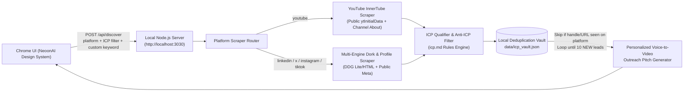

# Neoon Studio — Local ICP Discovery & Outreach Engine (Implementation Plan)

## 1. Goal Description
Build a local, zero-key **ICP Lead Discovery & Outreach Web Application** in `/Users/khallad/Documents/Workspace/NeoonStudio/marketing` that opens in Google Chrome (`http://localhost:3030`) and finds **10 net-new Ideal Customer Profiles (ICPs) on every run**.

The tool enforces the exact qualification and disqualification criteria in [icp.md](./icp.md), supports searching by platform across **YouTube, LinkedIn, Instagram, TikTok, and X (Twitter)**, guarantees **strict per-platform deduplication** across runs via a local persistent vault, and displays leads in a **fancy modern interactive table** matching the exact visual identity of `https://neoonai.com/neoon-studio/` (`../landing/index.html`).

---

## 2. Architecture & Data Flow

### Key Capabilities
1. **Strict 10-Lead Batch & Per-Platform Deduplication**:
   - Every run queries multiple rotated search queries/pages for the selected platform, filters out any lead whose normalized `platform + handle/channelId/profileUrl` already exists in `data/icp_vault.json`, and continues fetching until **10 brand-new ICPs** are collected for that run.
   - Each platform (`youtube`, `linkedin`, `instagram`, `tiktok`, `x`) maintains its own deduplication index so a client is never fetched more than once per platform.
2. **ICP Qualification & Anti-ICP Disqualification (`icp.md`)**:
   - **ICP 1 — The Stretched "DevRel" Team**: B2B Tech, SaaS, Developer Tools, API platforms, Cloud infrastructure, DevRel / Developer Advocates.
   - **ICP 2 — The "Silent" Tech Founder**: Bootstrapped SaaS, micro-SaaS, `#buildinpublic` founders, indie hackers, dev agencies ($10k+ MRR signals).
   - **ICP 3 — The High-Ticket Technical Educator**: Coding/tech tutorial creators (prioritizing the 10k–50k subscriber sweet spot on YouTube), cohort course instructors, bootcamps using basic screen-shares without motion graphics.
   - **Anti-ICP Filter**: Automatically rejects vloggers, lifestyle/gaming/entertainment creators, physical e-commerce brands, and beginner hobbyists.
3. **Personalized Outreach Pitch Generator**:
   - Generates a tailored, copy-ready outreach message (Short DM, Cold Email, and Voice-Note Hook) for each lead referencing their name, recent content/topic, detected pain point (e.g., *"great technical depth on [Topic], but basic screen-share editing is capping retention"*), and Neoon Studio's value proposition (*drop a voice note on Google Drive -> realistic avatar + lip-sync + zoom/b-roll + motion graphics in 24 hours with zero camera time*).

---

## 3. Visual Design System (Matching `neoonai.com/neoon-studio/`)
Extracted directly from `../landing/index.html`:
- **Color Palette**:
  - Background: `#07070b` (`--kh-bg`) with animated SVG noise grain overlay (`.kh-grain`)
  - Primary Text: `#ededf2` (`--kh-fg`), Muted Text: `#8b8b9a` (`--kh-muted`)
  - Borders & Dividers: `rgba(255, 255, 255, 0.09)` (`--kh-line`)
  - Brand Accents: Electric Violet `#7c5cff` (`--kh-a1`) & Cyan `#22d3ee` (`--kh-a2`)
  - Live Status Dot: `#3ee08f` pulsing indicator (`.kh-dot`)
- **Typography**:
  - Display Headings: `'Syne', sans-serif` (700/800 weight, tight tracking)
  - Body & Table Content: `'Inter', sans-serif`
  - Badges, Metrics & Tags: `'JetBrains Mono', monospace`
- **Fancy Modern Table Columns & Actions**:
  1. **Client / Channel**: Avatar/Initials, Name, `@handle`, clickable Profile Link, external Website/Social badges.
  2. **Platform & ICP Tier**: Platform badge + `ICP 1: DevRel`, `ICP 2: Silent Founder`, or `ICP 3: Tech Educator` + ICP Match Score (`75–99%`).
  3. **Audience & Content Signal**: Subscribers/Followers count, Recent Video/Post Title, Detected Buying Signal from `icp.md`.
  4. **Video Gap Analysis**: Specific reason they need Neoon Studio's voice-note-to-video pipeline.
  5. **Personalized Pitch**: 1-click Copy Pitch button + slide-over **Outreach Studio Modal** (switch between Short DM, Cold Email, and Arabic/English templates, or edit inline).
  6. **Outreach Status**: Interactive status selector (`New`, `Contacted`, `Replied`, `Booked`, `Disqualified`) saved automatically to disk.

---

## 4. Proposed File Structure in `marketing/`

- `marketing/package.json` — Dependencies & `npm start` / `npm test` scripts.
- `marketing/server.js` — Local Node.js API & static server on port `3030` with auto-launch in Google Chrome.
- `marketing/src/vault.js` — Persistent per-platform deduplication engine (`data/icp_vault.json`).
- `marketing/src/icpClassifier.js` — `icp.md` scoring, tier classification, Anti-ICP rejection, and personalized pitch generator.
- `marketing/src/scrapers/youtube.js` — Zero-key YouTube `ytInitialData` channel & video scraper.
- `marketing/src/scrapers/socialPlatforms.js` — Zero-key multi-platform discovery scraper for LinkedIn, Instagram, TikTok, and X (Twitter).
- `marketing/public/index.html` — Neoon Studio themed dashboard & fancy modern table UI.
- `marketing/public/app.js` — Frontend logic for platform switching, running 10-lead batches, filtering, pitch copying, and CSV export.
- `marketing/test/verify.js` — Automated test verifying 10 new ICPs per run, 0 duplicate clients across runs per platform, and Anti-ICP filtering.

---

## 5. Verification Plan
1. **Automated Verification (`npm test`)**:
   - Run 2 consecutive batches per platform (`youtube`, `linkedin`, `instagram`, `tiktok`, `x`) and assert that each run returns **10 valid ICPs** with **zero duplicates** across runs on the same platform.
   - Assert that Anti-ICP profiles (vloggers, lifestyle, physical e-commerce) are automatically disqualified.
2. **Live Chrome Verification (`npm start`)**:
   - Launch `http://localhost:3030` in Google Chrome, run live 10-ICP searches across platforms, verify the Neoon Studio UI styling, test the Outreach Pitch modal, status persistence, and CSV export.
